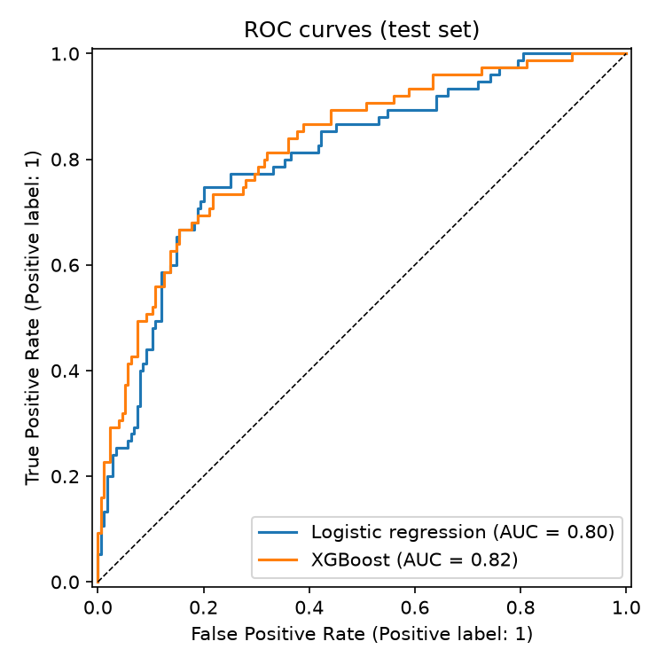
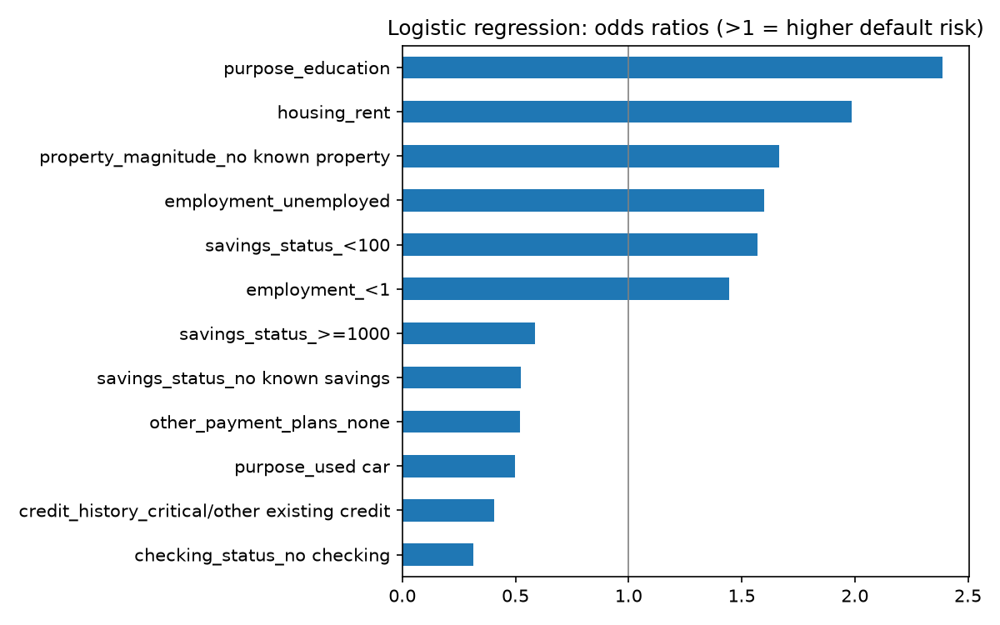
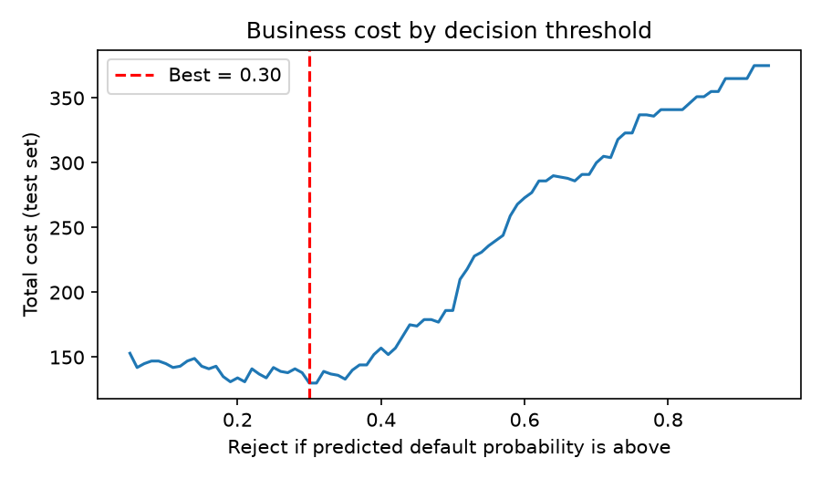

# Credit Risk Model: Predicting Loan Defaults

When a bank approves a loan, it is making a judgement about whether that person will pay it back. In this project, I used data on 1,000 past loan applicants to see how well that judgement can be made from data, and how a bank might turn a model's prediction into a sensible lending decision.

## The data

I used the German Credit dataset, which is publicly available on OpenML ("credit-g"). Each of the 1,000 applicants has 20 details recorded, such as their checking account balance, loan amount, loan purpose, savings and employment, along with whether they turned out to be a good or bad credit risk. Overall, 30% defaulted.

## How I approached it

1. **Explored the data with SQL.** I loaded the data into a SQLite database and used SQL queries (`GROUP BY`, `HAVING` and `CASE`) to compare default rates across different groups of applicants.
2. **Removed sensitive information.** I took out `personal_status`, which combines sex and marital status, and `foreign_worker`, because a bank shouldn't base lending decisions on them.
3. **Built two models.** I trained a logistic regression, the traditional and easily explained choice for credit scoring, and an XGBoost model, to see whether machine learning could do better. Both learned from 75% of applicants, and I tested them on the remaining 25%.
4. **Chose an approval cut-off based on cost.** Approving someone who defaults costs 5 times as much as turning away someone who would have repaid, so I chose the cut-off that kept the total cost of mistakes as low as possible.
5. **Checked for fairness.** I compared how often younger and older applicants were approved, and how often they actually defaulted.

## What I found

**Who defaults most often (SQL)**

| Factor | Highest default rate | Lowest default rate |
|---|---|---|
| Checking account | Negative balance: 49% | No checking account: 12% |
| Loan purpose | Education: 44% | Used car: 17% |
| Loan length | Over 2 years: 44% | Up to 1 year: 21% |

**How well the models performed (test set)**

| Model | AUC | Gini |
|---|---|---|
| Logistic regression | 0.803 | 0.61 |
| XGBoost | 0.818 | 0.64 |

XGBoost scored slightly higher, but the difference is small for a test set of 250 people. Because lenders need to be able to explain why someone was refused, I chose logistic regression as the model to base decisions on.



**What drives risk.** Loans for education, renting, having no property, being unemployed and having low savings all increased the chance of default. Applicants without a checking account and those buying a used car were lower risk.



**Setting the approval cut-off.** Rejecting applicants with more than a 30% predicted chance of defaulting, instead of the usual 50%, reduced the cost of wrong decisions by 30% (from 186 to 130 on the test set), while still approving around 59% of applicants.



**Fairness.** Under-25s were approved less often (46% compared with 62%), but they also defaulted much more often (52% compared with 25%). So the gap reflects a real difference in repayment rather than bias, though with only 48 younger applicants in the test set, it's something that would need ongoing monitoring.

## Limitations

- With only 1,000 applicants, results from a 250-person test set can vary by chance.
- The data comes from Germany in the 1990s, so it may not reflect UK borrowers today.
- The data only includes people the bank approved, so the model can't learn about those who were turned down. This can produce surprising results. For example, a "critical" credit history appears to *lower* risk, probably because only the strongest of those applicants were approved.
- The 5-to-1 cost ratio is the dataset's standard guide, not a real bank's figures.

## Running it yourself

Install the libraries:

```
pip install -r requirements.txt
```

Then open `credit_risk_model.ipynb` and run all the cells. The data downloads automatically from OpenML.

## What I would do next

- Use cross-validation to get more reliable results from a small dataset
- Use SHAP values to explain individual decisions made by the XGBoost model
- Try the same approach on a larger, more recent dataset